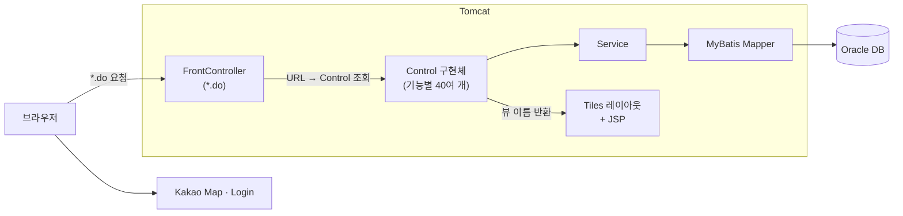

<div align="center">

# LotteryRoom

**로또 구매 · 당첨 결과 · 판매점 찾기를 한 사이트에서 하는 모의 로또 웹 서비스**

마일리지로 로또를 자동/수동으로 사고, 회차별 결과를 확인하고, 근처 판매점을 지도에서 찾을 수 있습니다.<br/>
프레임워크 없이 Servlet · JSP로 MVC 구조를 직접 구성한 팀 프로젝트입니다.


</div>

<!-- 스크린샷: 이미지를 넣고 경로를 바꿔주세요 -->
<!--
| 메인 | 로또 구매 | 판매점 지도 | 마이페이지 |
|:---:|:---:|:---:|:---:|
|  |  |  |  |
-->

## 📌 프로젝트 소개

| 항목 | 내용 |
|---|---|
| 종류 | 팀 프로젝트 (5명) <!-- 과정명/조 이름에 맞게 수정해주세요 --> |
| 기간 | 2023.05 (단기 프로젝트) |
| 원본 | [mrkim82/LotteryRoom](https://github.com/mrkim82/LotteryRoom) |
| 목표 | Spring 없이 Servlet · JSP · MyBatis만으로 MVC 웹 서비스를 끝까지 만들어 보기 |

> 이 저장소는 팀 프로젝트 LotteryRoom을 커밋 기록과 함께 옮겨온 개인 포트폴리오용 사본입니다.

## ✨ 주요 기능

| 기능 | 설명 |
|---|---|
| 🎰 **로또 구매** | 자동 · 수동 번호 선택, 한 번에 최대 5게임, 마일리지로 결제 |
| 🏆 **당첨 결과** | 회차별 당첨 번호 조회, 실시간 당첨 결과 화면 |
| 📍 **판매점 찾기** | 판매점 목록 · 검색, 카카오맵으로 위치 표시 |
| 💰 **마일리지** | 마일리지 충전, 구매 시 차감, 화면에 바로 반영 |
| 📰 **멀티 게시판** | 공지사항 · 언론보도 · 커뮤니티를 게시판 하나로 운영, 댓글 |
| 🙋 **고객센터** | FAQ, 1:1 문의 |
| 👤 **회원** | 회원가입, 로그인 · 카카오 로그인, 아이디 · 비밀번호 찾기, 마이페이지(정보 수정 · 탈퇴) |

## 🛠 기술 스택

| 분류 | 기술 |
|---|---|
| Backend | Java, Servlet, JSP, JSTL |
| Persistence | MyBatis 3.5, Oracle DB (ojdbc8) |
| View | JSP, Apache Tiles 3 (레이아웃), JavaScript |
| 외부 연동 | Kakao Map API, 카카오 로그인 |
| 기타 | Lombok, Gson, COS(파일 업로드), Maven(WAR), Tomcat |

## 🏗 아키텍처



## 🔥 기술적 고민과 해결

### 1. 프레임워크 없이 요청을 정리하는 방법: Front Controller 패턴
- **문제:** 기능마다 서블릿을 하나씩 만들면 `web.xml` 매핑이 끝없이 늘어나고, 인코딩 설정 같은 공통 처리가 여러 곳에 흩어집니다.
- **해결:** 모든 `*.do` 요청을 `FrontController` 하나가 받습니다. URL과 `Control` 구현체를 `Map`에 등록해 두고(커맨드 패턴), 요청 URL로 꺼내서 실행합니다. `Control.execute()`가 돌려준 값의 끝으로 응답 방식을 정합니다. `.do`로 끝나면 redirect, `.json`이면 JSON 응답(AJAX), 그 밖에는 JSP · Tiles로 forward합니다. 기능을 추가할 때는 클래스 하나와 `map.put` 한 줄만 쓰면 됩니다.
- 📄 `FrontControl/FrontController.java`, `FrontControl/Control.java`

### 2. 화면마다 반복되는 레이아웃: Apache Tiles
- **문제:** 상단 메뉴, 사이드 메뉴, 하단 영역을 JSP마다 include하면 메뉴 하나를 고칠 때 모든 화면을 손대야 했습니다.
- **해결:** Tiles 와일드카드 정의(`main/*`, `*/*`)로 **메인 레이아웃**과 **메뉴형 레이아웃** 두 가지만 만들었습니다. Control은 `"mypage/mypage.tiles"`처럼 뷰 이름만 돌려주면 알맞은 레이아웃이 자동으로 입혀집니다.
- 📄 `WEB-INF/tiles.xml`, `WEB-INF/layout/`

### 3. 게시판 세 종류를 테이블 하나로
- 공지사항(E), 언론보도(K), 커뮤니티(J)를 **게시판 유형 코드**로 나눠 테이블과 Control · Mapper를 하나씩만 두었습니다. 고객센터도 FAQ(F)와 1:1 문의(C)를 같은 방식으로 묶었습니다. 그래서 목록 · 상세 · 등록 · 수정 · 삭제 로직을 한 벌만 관리하면 됩니다.
- 📄 `multiboard/`, `csboard/`

### 4. 마일리지 결제와 화면 반영
- 로또를 사면 DB에서 마일리지를 차감하고, 세션에 들고 있는 마일리지 값도 같이 갱신합니다. 상단 메뉴의 잔액이 페이지를 다시 불러오지 않아도 바로 맞게 보입니다. 한 번에 여러 게임을 사면 게임마다 구매 기록과 번호를 따로 저장합니다.
- 📄 `lotto/control/AddAutoControl.java`, `lotteryuser/control/MinusMileageControl.java`

## 👤 담당 역할

<!-- 실제 역할에 맞게 수정해주세요 -->
- **마이페이지:** 회원 정보 조회 · 수정 화면, 회원 탈퇴 화면과 처리 (PR #4)
- **공통 레이아웃:** 상단 메뉴(`top.jsp`) 개편, 대시보드 레이아웃 정리, 회원가입 · 마일리지 충전 화면 수정 (PR #7)

## 📂 폴더 구조

```
LotteryRoom/src/main/
├── java/com/lottery/
│   ├── FrontControl/        # FrontController, Control 인터페이스
│   ├── main/                # 메인 화면
│   ├── lotteryuser/         # 회원 · 로그인 · 마이페이지 · 마일리지 · 로또 구매
│   ├── lotto/               # 로또 번호 저장 · 회차별 결과
│   ├── store/               # 판매점 목록 · 검색 · 지도
│   ├── multiboard/          # 공지 · 언론보도 · 커뮤니티
│   ├── csboard/             # FAQ · 1:1 문의
│   ├── reply/               # 댓글
│   └── common/              # DataSource(MyBatis), 페이징, DB 설정
│       (각 도메인: control / service / mapper / domain)
└── webapp/
    ├── WEB-INF/
    │   ├── views/           # 화면 JSP (main, mypage, store, lottoresult ...)
    │   ├── layout/          # Tiles 레이아웃 (dashboard, dashmenu, top ...)
    │   ├── tiles.xml
    │   └── web.xml
    ├── css/
    └── images/
```

## 🚀 실행 방법

1. Oracle DB를 준비하고 `src/main/java/com/lottery/common/db.properties`에 접속 정보를 넣습니다.
2. Eclipse 등에서 Maven 프로젝트로 가져온 뒤 Tomcat 서버에 올려 실행합니다.
3. 브라우저에서 `http://localhost:<포트>/<컨텍스트>/main.do`로 접속합니다.

```bash
# WAR 빌드
cd LotteryRoom
mvn clean package
```

## 🔗 관련 레포

- [mrkim82/LotteryRoom](https://github.com/mrkim82/LotteryRoom): 팀 프로젝트 원본 저장소
- [Y-MODU](https://github.com/sunghyeon0073/Y-MODU): 협업 툴 팀 프로젝트
- [ANG-Capstone](https://github.com/sunghyeon0073/ANG-Capstone): 2026 캡스톤 그룹웨어 프로젝트
